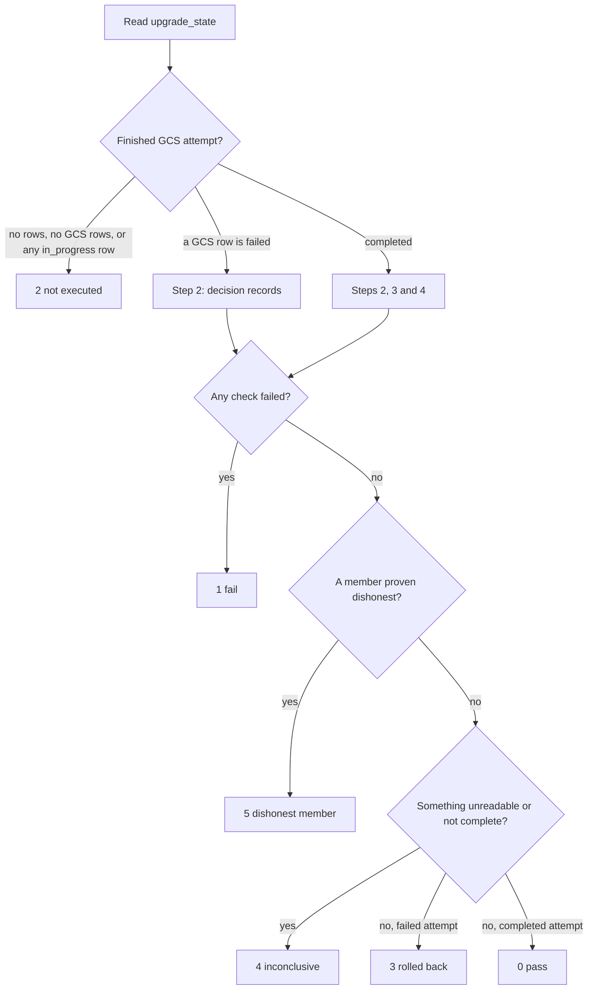

# upgrade-check

`upgrade-check` is a read-only command-line tool that checks one Blue/Green
upgrade attempt on one operator. It answers two questions:

1. What happened to the attempt: cut over, rolled back, or not executed yet?
2. If it cut over, is the result correct on this operator?

It never writes to the database, to S3 or to a chain, and it needs no signing
key. Every operator can run it on its own.

## What it needs

| Access | Used for |
| --- | --- |
| Postgres, read-only role, on the live coprocessor DB | `upgrade_state`, `versioning`, `consensus_epoch_history`, ciphertext tables |
| Gateway RPC | the registered coprocessors in `GatewayConfig`, and Gateway block times |
| HTTP read on every member's bucket URL | the signed decision records (`outcome.json`) and the relayed ones (`seen.json`) |
| S3 read on this operator's ciphertext bucket | the `ct64` and `ct128` objects |

## Run it

```bash
cargo run -p upgrade-controller --bin upgrade-check -- \
  --target-consensus-version 2 \
  --database-url "$DATABASE_URL" \
  --gateway-url "$GATEWAY_URL" \
  --gateway-config-address "$GATEWAY_CONFIG_ADDRESS" \
  --s3-url "$S3_URL" \
  --bucket "$BUCKET_NAME"
```

| Flag | Env variable | Default | Meaning |
| --- | --- | --- | --- |
| `--target-consensus-version` | `TARGET_CONSENSUS_VERSION` | required | consensus version the upgrade should activate |
| `--database-url` | `DATABASE_URL` | required | Postgres URL of the live DB |
| `--gateway-url` | `GATEWAY_URL` | required | Gateway RPC URL |
| `--gateway-config-address` | `GATEWAY_CONFIG_ADDRESS` | required | address of the `GatewayConfig` contract |
| `--s3-url` | `S3_URL` | required | S3 / MinIO endpoint of the ciphertext bucket |
| `--bucket` | `BUCKET_NAME` | required | ciphertext bucket name |
| `--access-key` | `AWS_ACCESS_KEY_ID` | `fhevm-access-key` | S3 access key |
| `--secret-key` | `AWS_SECRET_ACCESS_KEY` | `fhevm-access-secret-key` | S3 secret key |
| `--region` | `AWS_REGION` | `eu-west-1` | S3 region |
| `--context-id` | - | `1` | last part of the S3 key `ct64/<handle>/<context-id>` |
| `--digest-limit` | - | `0` | check at most this many handles in step 4 (`0` = all) |
| `--post-cutover-duration` | - | `60m` | how far past the cutover steps 3 and 4 reach (for example `5m`, `2h`) |
| `--json` | - | off | also print the full report as JSON on the last line |

## Verdicts and exit codes

| Exit code | Verdict | Meaning |
| --- | --- | --- |
| 0 | pass | the attempt cut over and every check passed |
| 1 | fail | at least one check failed |
| 2 | not executed | no finished attempt in `upgrade_state` |
| 3 | rolled back | the attempt failed and no check contradicts the rollback |
| 4 | inconclusive | an endpoint was unreachable, data was missing, or the checked range is not complete yet |
| 5 | dishonest member | no check failed, but a member provably signed both `quorum` and `abort` |



A runtime error (for example the DB or the Gateway RPC cannot be reached, or
the GCS rows name more than one `proposal_id`) also ends as inconclusive.

## What it checks

The tool runs one linear pass. It prints every SQL query and every URL before
it uses them, so each step can be replayed by hand with `psql` and the `aws`
CLI.

### Step 1: upgrade state (DB)

- Prints every `upgrade_state` row.
- Stops with "not executed" when there are no rows, no `GCS` rows, or any row
  with status `in_progress`. No later check runs in that case.
- Takes the attempt identity (`proposal_id`, `proposal_block`) from the `GCS`
  rows.
- Requires a `consensus_epoch_history` row for that attempt whose
  `consensus_version` equals the target.
- For a completed attempt: `versioning.consensus_version` must equal the
  target and the epoch outcome must be `succeeded`.
- For a failed attempt: an epoch outcome of `succeeded` is a failure.

### Step 2: decision records (Gateway + member buckets)

Each member signs one decision record for the attempt, `quorum` or `abort`,
and stores it in its own bucket as `outcome.json`. Each member also republishes
every record it has read as `seen.json`. A record is signed by its member, so a
copy relayed by a peer counts like the original.

What the tool does:

- Reads the registered coprocessors from `GatewayConfig` at the attempt's
  `gw_start_block`. If the Gateway no longer serves that block, it reads them
  at the Gateway tip and prints a warning.
- Fetches `outcome.json` and `seen.json` from every member's bucket.
- Verifies every record: it names this attempt, its signer is a registered
  member (for `outcome.json`: the owner of the bucket), the signer is in the
  record's own member set, the signature recovers to the signer, and the
  record is at most 16 KiB. An invalid record is dropped and the bucket that
  served it is named in a warning.
- Does not count a record that names another `target_stack_version`,
  `target_consensus_version` or member set (see "mismatch" below).
- Counts how many members signed each decision and compares with the fleet
  thresholds.

Thresholds, with `max_faulty = (members - 1) / 3`:

| Members | Max faulty | Cutover needs `quorum` from | Rollback needs `abort` from |
| --- | --- | --- | --- |
| 3 | 0 | 3 | 1 |
| 4 | 1 | 3 | 3 |
| 5 | 1 | 4 | 3 |
| 7 | 2 | 5 | 5 |

- Completed attempt: the `quorum` records must reach the cutover threshold.
  If the `abort` records reach the rollback threshold instead, or neither
  threshold is reached, the check fails. If neither is reached but a bucket was
  unreadable, the result is inconclusive.
- Failed attempt: the tool reports whether the `abort` records reach the
  rollback threshold, then stops with "rolled back". `quorum` records reaching
  the cutover threshold is a failure. Too few `abort` records is only a
  warning.
- A member with no record, or an unreadable bucket, is not a failure as long
  as the threshold is reached.
- On a completed attempt, `versioning.stack_version` must equal the proposal's
  version.

#### Misbehaving members

The tool groups all valid records by signer, across all buckets, and reports:

| Report | When | Effect |
| --- | --- | --- |
| `DISHONEST (proof)` | a member has a counted `quorum` record and a counted `abort` record for this attempt | both signed records are printed; exit code 5 unless a check failed |
| `SUSPECT (no proof)` | a peer relays a member's record, but the member's own bucket serves nothing, an invalid object, or a different record | warning only; this can also be an outage |
| `MISMATCH` | a member signed for another release or another member set | warning; the record is not counted |

Limits of this check:

- A member that never signed looks the same as a member that was down.
- `seen.json` is not signed as a list. An operator can leave records out of
  its own copy without a trace. One honest copy holding both records of a
  member is enough for the proof.
- An operator stops reading records once it cuts over or rolls back, so its
  `seen.json` can hold fewer records than its peers'. Fewer records is not a
  failure; conflicting records are.
- A dishonest member counts in both tallies, as it does for the operators. The
  thresholds tolerate up to `max_faulty` such members.

### Step 3: ciphertext consensus version (DB)

Steps 3 and 4 cover a bounded range, so two runs check the same data and a
pass means the whole range was there to check.

```
start_block            cutover time        scan cutoff            now
    |----------------------|-------------------|-------------------|
    |<------------- checked by steps 3 and 4 ->|   not checked
                           |<----------------->|
                           --post-cutover-duration (default 60m)
```

- Cutover time is `consensus_epoch_history.completed_at`, written by this
  operator's cutover transaction.
- Scan cutoff is cutover time plus `--post-cutover-duration`.
- Times are this operator's ingest times, not chain block times, so two
  operators can check slightly different ranges.
- The tool also prints the consensus anchor block per chain from the `quorum`
  records. This is where the fleet reached consensus; the cutover ran later.
  It is informational and does not bound the scan.

The checks:

- Outputs: for each chain, every completed, allowed, non-errored computation
  from the chain's `start_block` up to the last block ingested at or before
  the scan cutoff must have a `ciphertexts` row whose
  `consensus_version` equals the target.
- Inputs: every handle of a verified proof at or after `gw_start_block` (a
  Gateway block) that the gw-listener ingested at or before the scan cutoff
  must have a `ciphertexts` row whose `consensus_version`
  equals the target.

The run is inconclusive, not a pass, when the range is not complete yet:

| Case | Result |
| --- | --- |
| the scan cutoff is still in the future | inconclusive, re-run later |
| a host chain has no block ingested after the cutoff | inconclusive, the listener may be behind |
| the gw-listener has not scanned the Gateway up to the cutoff | inconclusive |
| the Gateway is quiet: the gw-listener is at the Gateway tip and the cutoff has passed | complete |

The Gateway only produces a block when it has a transaction, so with no inputs
there may be no Gateway block after the cutoff. The tool handles this by asking
the Gateway for the first block the gw-listener has not scanned yet
(`gw_listener_last_block.last_block_num + 1`). If that block does not exist,
the listener is at the tip and nothing is missing. If it exists and its time is
after the cutoff, everything up to the cutoff is scanned. Otherwise the
listener is behind.

A host chain has no such check, because the tool has no host RPC. A host chain
that stops producing blocks stays inconclusive.

### Step 4: digest consistency (DB vs S3)

For the outputs of step 3 and for the step 3 inputs present in
`allowed_handles` (so the same bounded range), and
for both `ct64` and `ct128`, the tool compares three values:

- the keccak256 of the ciphertext bytes in the DB,
- the digest recorded in `ciphertext_digest`,
- the keccak256 of the S3 object.

| Result | Counts as |
| --- | --- |
| all present values agree | ok |
| DB bytes pruned, recorded digest equals S3 | ok |
| no recorded digest, DB bytes equal S3 | ok |
| nothing exists anywhere (for example no `ct128` was produced) | ok |
| object missing in S3, missing in the DB, or any two values differ | failure |
| S3 could not answer | inconclusive |

One anomaly is tolerated: on an output computed exactly at a chain's
`start_block`, a Blue digest row can survive the merge. It is printed as
`KNOWN-CUTOVER-BOUNDARY` and counted as a warning, not as a failure.

## Limits

- An attempt that is still `in_progress` (including a stalled one) only gets
  its `upgrade_state` rows printed. The tool does not analyze why it stalled.
- S3 access uses a static access key and secret key with path-style
  addressing. Session tokens and role-based credentials are not supported.
- Step 4 checks handles one at a time and downloads each object in full. Use
  `--digest-limit` on a large DB; it keeps the first handles in scan order.
- Long failure lists are capped: 20 per kind (missing row, wrong version) per
  chain in step 3, and 50 in step 4. The counters in the summary lines and in
  the JSON report are complete.
- The binary is not part of the `upgrade-controller` Docker image. Build it
  from source.
