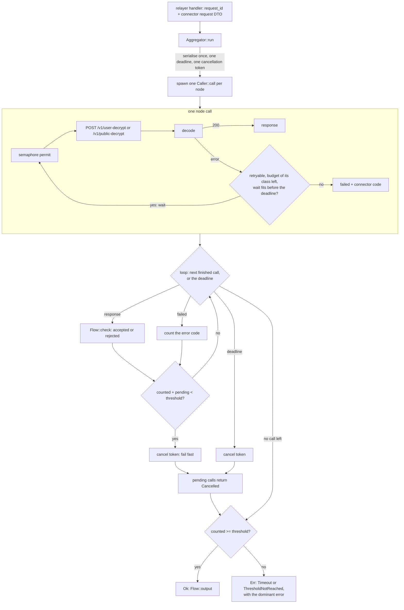
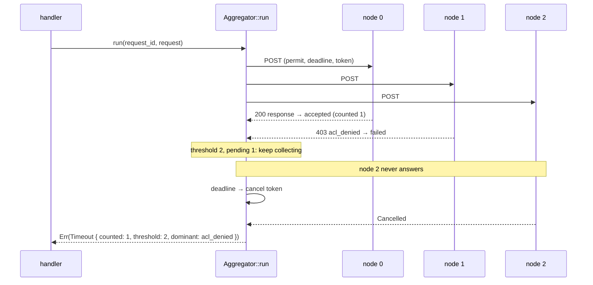
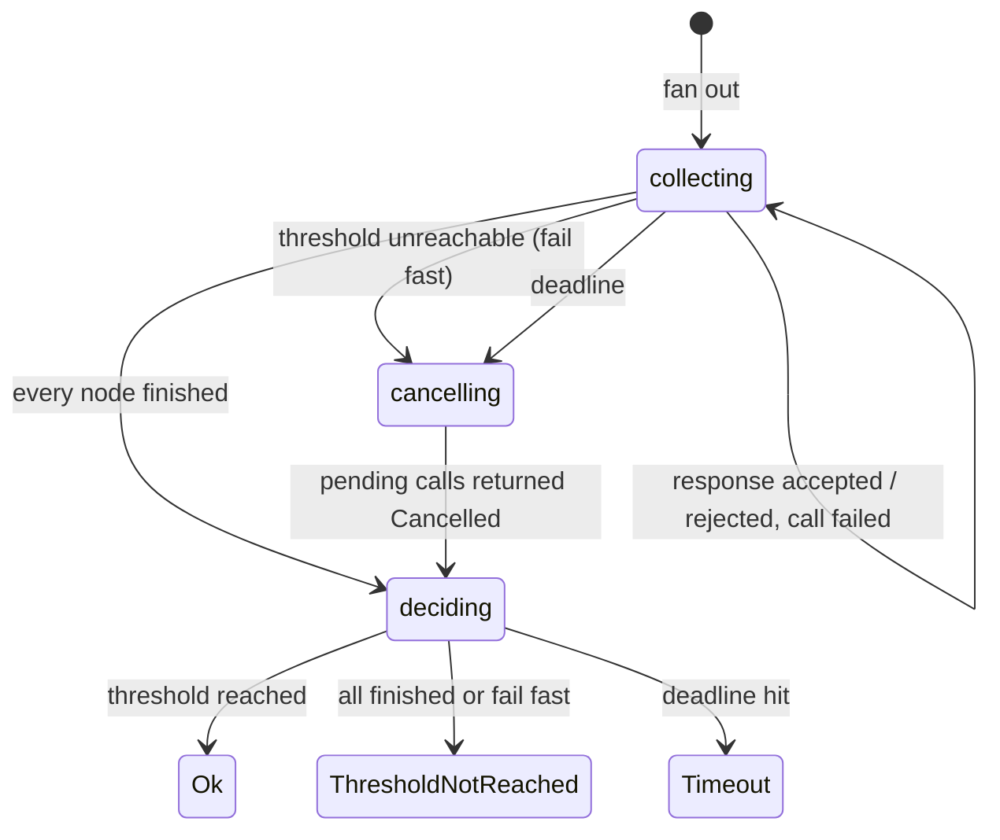
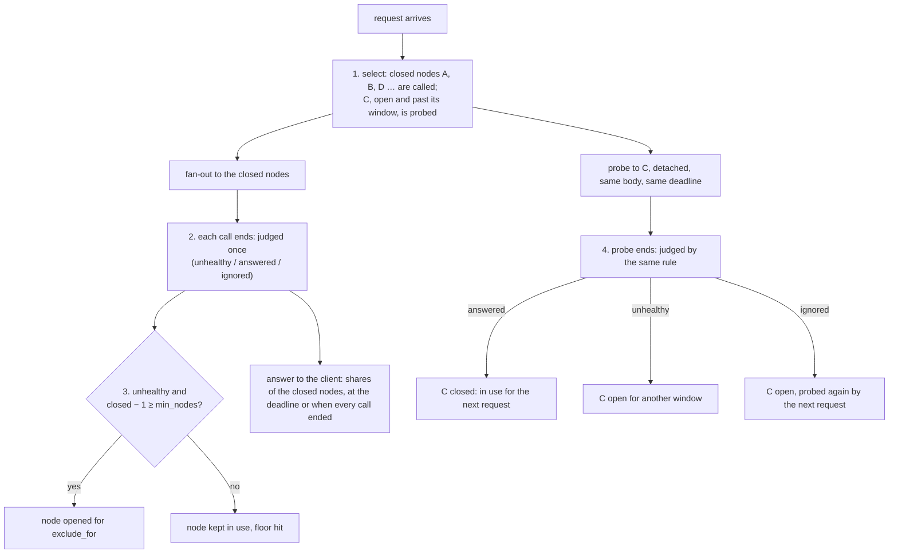
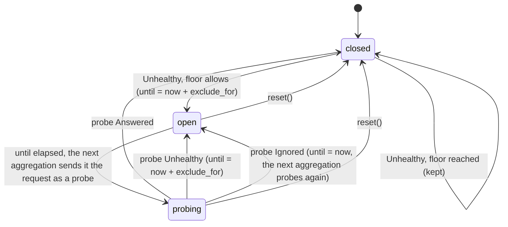

# kms_aggregator

Minimal first version. Posts one decryption request to every KMS connector endpoint and turns their answers into one
result. Reading order: this file, `aggregator.rs`, `call.rs`, `client.rs`, `flows/`, `config.rs`.

## 1. What it is

- Fans out `POST /v1/user-decrypt` or `POST /v1/public-decrypt` (request and response DTOs from the `kms-connector-api`
  crate) to the `n` configured nodes.
- Collects the answers until every node has finished or the deadline (`call.timeout`) passes.
- Answers `Ok(output)` when `counted >= threshold`, otherwise a typed error that carries the counts and the dominant
  connector error.
- Is called by the handlers in `endpoint/` (see `endpoint/docs.md`) with the relayer's own `request_id` and the
  connector request DTO. The handlers, and everything before them, are out of the scope of this file.

## 2. Overall scheme



One aggregation over time (three nodes, one hangs):



The decision, as a state machine:



## 3. Vocabulary

| term | meaning |
|---|---|
| node | one KMS connector endpoint (`endpoints[i]`, named in logs as `kms_node`) |
| accepted | a `200` response that passed `Flow::check` |
| counted | accepted responses that count toward the threshold: all of them for user decrypt, the largest agreeing group for public decrypt |
| threshold | counted responses needed to answer (configured per flow, `1 <= threshold <= n`) |
| deadline | `call.timeout` after the start: the aggregation, and every call in it, ends by then |
| fail fast | `counted + pending < threshold`: even if every pending node answered we could not make it, so stop now |
| dominant error | the most frequent connector error code among the failed calls; carried by the error for the caller to act on |
| `request_id` | the relayer's own correlation id, passed to `run`, on every log line; never sent to the nodes |
| `decryptionId` | the connector's content hash of the request body, recomputed by every node; logged, never checked |

## 4. How an aggregation runs (`Aggregator::run`)

1. Serialise the request once. Ask the circuit breakers which nodes to call and which excluded ones to probe
   (section 7; every node and no probe while the breakers are off). Spawn one task per selected node
   (`Caller::call`) sharing the body bytes, the deadline and a cancellation token of its own, and one detached probe
   per probed node, which the aggregation never waits for.
2. Loop on the next finished call or the deadline timer (the deadline is checked first).
3. A `200` goes through `Flow::check` and is accepted or rejected. A failed call is counted with its connector code. A
   cancelled call is counted.
4. After every result, fail fast if `counted + pending < threshold`: cancel the token; the pending calls return at once.
5. At the deadline: cancel the token, drain the pending calls (immediate), then decide.
6. Decide once, after the loop:

| state at the end | result |
|---|---|
| `counted >= threshold` | `Ok(Flow::output(accepted))` |
| deadline hit | `Err(Timeout { counted, threshold, dominant })` |
| otherwise (every node finished, or fail fast) | `Err(ThresholdNotReached { counted, threshold, dominant })` |

Two consequences to keep in mind: a single hung node makes that request last the full `call.timeout` (accepted: the
answer then carries every share that arrived; with the circuit breaker on, section 7, only the request that detects
the hung node does, the next ones leave it out), and responses that would have arrived after the answer are
cancelled, not stored.

The instant the counted responses first reach the threshold is `Tally::threshold_reached`: the summary line reports it
as `threshold_reached_ms` (from the request's receipt), and `run` observes the time from it to its end in
`relayer_http_kms_wait_after_threshold_seconds{flow}`: the latency the wait for the remaining nodes adds.

## 5. One node call (`Caller::call`)

`sign → permit → POST → decode → retry?`, under the cancellation token.

- Each call signs its node's `FhevmSig` header (RFC-038, `signer.rs`): an EIP-712 signature over the route, the
  `keccak256` of the exact body, an expiry (`auth.validity` from now) and the node's `audience` (its KMS tx-sender
  address), sent as `authorization: FhevmSig expires=<unix seconds>, digest=0x<keccak256(body)>, sig=0x<65 bytes>`.
  The calls sign in parallel, outside the semaphore, so a slow signer (AWS KMS) never holds a slot. The header is
  reused by every attempt of the call (`auth.validity > call.timeout`), and re-signed after an `auth_expired` answer
  (clock drift between the relayer and that node).

- The semaphore (`max_concurrent_calls`) bounds HTTP calls in flight across all aggregations of the process. A permit
  is held for one attempt only, never while sleeping between attempts.
- Retries happen only for retryable errors, in two budgets chosen by the class of the failure
  (`AttemptError::retry_class`), each consumed once per call and never restarted; the waits, the classes and their
  rationale are section 6. The deadline is the real bound: a retry whose wait does not fit in the remaining time is
  skipped (the call gives up), so no call outlives `call.timeout`.
- An authentication rejection (`sender_authentication_failed`, a bare 401) is never retried: our key or that node's
  audience is wrong. `auth_expired` is retried like any retryable error, with a fresh header.
- The reqwest client has `timeout(call.timeout)` and a 3 s connect timeout as safety nets for a socket that stops
  answering. The aggregator's deadline is the decision.
- The reqwest client verifies every connector's TLS certificate with the platform verifier (system roots).
  `skip_tls_verification` turns that off (no CA, expiry or hostname check), for local or devnet stacks only; startup
  then logs a `warn`.

| connector answer | `AttemptError` | retried? |
|---|---|---|
| 2xx with a valid DTO | — | — |
| 2xx with an unreadable body | `Body` | no |
| any body above 4 MiB (declared `content-length`, or bytes received when the stream is cut) | `TooLarge(bytes)` | no |
| non-2xx with the connector error body | `Api { status, error }` | by `error.code`: `malformed`, `unsupported_attestation_type` (400), `sender_authentication_failed` (401), `user_decryption_expired` (403), `kms_context_destroyed` (410), `unprocessable` (422) are final; `auth_expired` (401, re-signed), `acl_denied`, `user_signature_rejected` (403), `ciphertext_not_found` (404), `kms_context_invalid` (412), `copro_consensus_failed`, `upstream_transient` (502), `overloaded` (503), `timeout` (504) retry in the transient budget; `rate_limited` (429) in the rate-limit budget; `unknown` follows the body's `retryable` flag |
| non-2xx without a JSON body (empty 404, HTML 502, a 3xx: never followed) | `Status` | 408 and 5xx (transient budget), 429 (rate-limit budget) only |
| connection refused or reset, TLS failure, client-side timeout | `Transport` | yes |
| the header could not be signed (AWS KMS unreachable); nothing was sent | `Signer` | yes |

For the dominant error, a bare 401 counts as `sender_authentication_failed`, a bare 429 as `rate_limited`, a transport
failure or a bare 5xx as `upstream_transient`, a bad 2xx body or a signing failure as `unknown`. The connector proxy
limits each sender to `rate_limit_per_second` requests over a fixed 1 s window and answers `429 rate_limited` with
`Retry-After: 1`; the bare 429 covers an ingress limit in front of it.

## 6. Retry policy

A failed attempt is retried only if the connector marks its code retryable (`kms-connector-api`, never redefined
here), and then by one of two budgets, chosen by the class of the failure. Each budget is consumed once per call
and never restarts, whatever the other class does in between.

| class | failures | wait before retry `k` | budget |
|---|---|---|---|
| transient | every retryable failure except a rate limit: `acl_denied`, `ciphertext_not_found`, `copro_consensus_failed`, `auth_expired`, `kms_context_invalid`, `overloaded`, `timeout`, `upstream_transient`, bare 408/5xx, transport, signing | `retries.waits[k-1]` | the length of `retries.waits` |
| rate limit | `rate_limited`, a bare 429 | `max(rate_limit.initial_delay, Retry-After) * 2^(k-1)` | `rate_limit.max_retries` |

**Transient: the list is the policy.** `retries.waits` names the wait before each retry, in order; `[]` is a single
attempt. There is no curve formula: the operator shapes the list. What the stack shows about these failures decides
the shape. They clear when something slow happens elsewhere: the coprocessors' attestations reach the connector's
consensus threshold on S3, the ACL update lands on the host chain. That takes seconds, not a fixed delay, and nothing
retries after the relayer: below the threshold it answers the dominant code as is, with the connector's status and
no `retryable` indication (`endpoint/docs.md` section 5), and the SDK's relayer-http request makes one HTTP attempt
(`sdk/js-sdk`, `RelayerHttpRequest`; it retries network failures only), so the relayer's retries are the only ones a
decryption gets unless the dapp sends the request again. Two short waits first catch a jitter cheaply; longer waits
after reach the deadline instead of giving up with half of it unused. The default `[200ms, 300ms, 500ms, 800ms, 1s]`
is 2.8 s of waits under the 5 s deadline, up to 6 attempts per node.

**Rate limit: one window, then back off.** The connector proxy counts requests per sender over a fixed 1 s window
(`rate_limit_per_second`, 100 by default) and answers `429 rate_limited` with `Retry-After: 1`. Retrying inside the
window that rejected the call is a guaranteed second 429 and one more unit of the budget spent, so the first retry
waits a whole window (`initial_delay`, 1 s), and the header raises that floor when the proxy asks for more
(delta-seconds only, at most 60 s; any other form is ignored). One retry by default: the limit is per sender per
node, so an over-budget relayer is rejected by every node in the same window, and a second retry here would only
spend the next window of every node; the request is answered `429 rate_limited` instead. More retries double the
wait each time, so a sustained 429 backs off instead of hammering.

**The deadline bounds both.** A wait that would end after `call.timeout` is skipped and the call gives up
(`give_up_reason: deadline`), so no call outlives the aggregation. The deadline itself is at least 1 s. Startup
refuses a list, or a rate-limit budget, whose waits alone cannot all start before the deadline, and names the first
retry that could never run (section 10).

**Cost.** Every retry is one more request to that node, counted by its proxy against the sender's 100 per second.
With the default list a decryption that keeps failing costs up to 6 requests per node (13 nodes: 78), spread over
2.8 s, so a burst of about 40 such decryptions in one second saturates a node's window. The relayer checks neither
the ACL nor the ciphertext before the fan-out (section 14), so a decryption that is not ready pays the whole list on
every node. A longer list buys coverage of the deadline at that price; `relayer_http_kms_attempts` shows what calls
actually use.

**Observing it.** Each failed attempt is one WARN line with its decision: `retry_class`, `retry_in_ms` (null when
the call gives up), `retry_after_ms`, `give_up_reason`; `call failed` carries `transient_retries` and
`rate_limit_retries`, and `aggregation started` (debug) the policy itself (section 12). The scenarios
`transient_waits_are_the_list`, `rate_limit_waits_one_window`, `rate_limit_honors_retry_after`,
`rate_limit_backoff_then_success` and `mixed_classes_on_one_call` pin the timings under virtual time (section 13).

## 7. Circuit breaker (`breaker.rs`)

Off by default (`circuit_breaker.enabled`); with the flag off the code path is section 4's. In plain words:

Every KMS node has a switch. Closed means the node is used, open means it is skipped.

1. A request is sent to the closed nodes only.
2. When a node's call ends, it is judged once. Unhealthy means the node could not be reached, answered 502, 503 or
   504, or gave no answer at all before the deadline. Anything else means healthy, including a request error such as
   `ciphertext_not_found` or `acl_denied`, even when the deadline cut the last retry.
3. An unhealthy node is opened for `exclude_for` (30 s), unless that would leave fewer than `min_nodes` closed nodes.
   Then it stays in use and the requests stay slow.
4. After the window, the next request is also sent to the opened node, as a probe. The request does not wait for the
   probe. If the probe answers, the node is closed again. If not, it is opened for another window.
5. `Caller::reset_circuit_breakers()` closes every node.

Seen from outside: only the request that detects an outage is slow, once per pod per outage. Every request after
it runs at healthy speed with one share fewer, the probing one included, since nothing ever waits for a probe. With
more unhealthy nodes than the floor allows, requests are slow again, as without a breaker. With no traffic nothing
happens: there is no timer and no health call of its own.

The same five steps as one request goes through them, with node C open and its window elapsed. Steps 1 and 4 are
the selection, step 2 the verdicts, step 3 the floor; the probe runs beside the aggregation and only its verdict is
kept:



**Verdict** (`Verdict::of`, one pure function on a finished call, after the retries of section 6 are spent):

| verdict | final outcome of the call | reading |
|---|---|---|
| `Unhealthy { last_code }` | `Failed` with code `upstream_transient` (a transport error, a bare status, the proxy without a healthy backend, the endpoint's storage or stream, the worker's transient failures), `overloaded` (503, the endpoint's in-flight cap) or `timeout` (504); `Cancelled` at the deadline with no answer during the call, or whose last answer was one of those three codes | the node, or the path to it, could not serve for the whole call |
| `Answered` | any other answer: accepted or rejected `200`; `ciphertext_not_found`, `acl_denied`, `copro_consensus_failed`, `kms_context_*`, `user_*`, `malformed`, `unsupported_attestation_type`, `unprocessable`, `unknown`; `rate_limited` and a bare 429 (our send rate); `sender_authentication_failed`, `auth_expired` (our signature or clock); an unreadable or oversized 2xx body; `Cancelled` at the deadline whose last answer was one of these | the node is up: the request, the ciphertext, the ACL or our side was the problem; an answer the relayer cannot classify never excludes a node |
| `Ignored` | `Cancelled` by fail fast; a signing failure (nothing was sent); a node task panic; a `client_closed` cut (never reaches the aggregator) | nothing is known about the node |

Why the deadline alone is not a signal: a healthy node answering `ciphertext_not_found` is retried until its next
wait does not fit before the deadline; if its last attempt is still in flight when the deadline fires, the call ends
`Cancelled` exactly like a hung node's. `CallResult::last_code`, the code of the node's last answer during the call
(`None` when it never answered), tells them apart; `call cut` logs it as `last_code`.

**States and transitions** (`CircuitBreakers`, one per `Caller`, so one set for both flows: a node excluded
because of a user-decrypt call is excluded for public decrypt too):



- `select(now)`: before the fan-out, the closed nodes to call and the open nodes whose window has elapsed to probe;
  each probed node becomes `probing`, so concurrent aggregations send it one probe at a time. Half-open is not a
  state: it is an open node whose `until` has passed, seen by the next `select`. There is no timer.
- `on_call_outcome`: `Unhealthy` opens a closed node when `closed − 1 >= min_nodes` (open and probing nodes do not
  count), else keeps it; `Answered` and `Ignored` change nothing; an outcome for a node another aggregation opened
  meanwhile, or of a call started before a `reset()` (the selection's `generation` is echoed back), is dropped.
- `on_probe_outcome`: `Answered` closes; `Unhealthy` opens for another window; `Ignored` sets `until = now`.
- `reset()`: every node closed, generation bumped. For the dynamic configuration, when the endpoint list is
  refreshed; a committee change (node count or thresholds) rebuilds the `Caller`, since the floor's bounds depend on
  both.
- The probe (`Caller::probe`): the same body sent by a detached task with the aggregation's deadline and its own
  cancellation token; cut at that deadline, so a hung node ends it `Cancelled` with no answer, judged by the same
  function. Its call runs as a child task, so a panic inside it is a `JoinError` and the verdict `Ignored`, never a
  node left probing. Observe-only: no channel back to the aggregation, nothing to join; fail fast, the end of the
  aggregation and a client that hangs up do not cancel it. Its attempts are recorded in the node metrics under the
  request's flow.

**State.** One mutex per pod around `State`: the switches, the two settings and a generation counter.

| concept | scope | what it is |
|---|---|---|
| switch | per node | `closed`, `open { since, until }` or `probing { since }`; one per endpoint, in endpoint order |
| `until` | per node | the instant the node was opened plus `exclude_for`; the only thing `select` reads |
| `since` | per node | when the node was first opened; kept through a failed probe; reported as `excluded_ms` |
| `exclude_for`, `min_nodes` | shared | the two settings; a window is never global, each node starts its own when opened |
| closed count | derived | counted from the switches at each outcome, never stored; an open or probing node is not closed |
| `generation` | shared | bumped only by `reset()`; copied into each `Selection` and echoed back by its outcomes, so a call started before a reset changes nothing; unrelated to time and to nodes |
| time | passed in | `select` gets the aggregation's start, the outcomes get the instant the call or probe ended: a hung node is opened at the deadline, a refused one at once |

No timer and no global window: a node whose window ended is probed by the first request that arrives afterwards,
not at that instant.

**Two exclusions, one second apart** (13 nodes, `min_nodes` 11, `exclude_for` 30 s):

| when | event | closed |
|---|---|---|
| t | node 1 unhealthy, 13 > 11: opened until t+30 | 12 |
| t+1 | node 2 unhealthy, 12 > 11: opened until t+31 | 11 |
| t+2 | node 3 unhealthy, 11 is not > 11: kept, `node kept: floor reached` | 11 |
| t+10 | a request: both windows running, fan-out to 11 nodes, no probe | 11 |
| t+30.5 | first request after t+30: node 1 probing, one detached probe; node 2 still open | 11 |
| t+30.7 | a request during the probe: node 1 still out, no second probe | 11 |
| t+31.2 | node 1's probe answers (any answer): closed, `node included` | 12 |
| t+31.5 | first request after t+31: node 1 called, node 2 probing | 12 |
| t+32 | node 2's probe is refused: opened until t+62, `since` still t+1, `probe failed: node excluded` | 12 |

One request at t+40 with none before probes both nodes at once. Between t+30.5 and t+31.2 node 3 could not be
opened: a probing node is not closed, so the floor was still reached.

**Concurrency.** One `std::sync::Mutex` for the set, taken for two short critical sections per aggregation
(`select` once, `on_call_outcome` once per outcome) and never held across an await. The floor is checked and applied
in the same critical section: with k concurrent unhealthy outcomes and room for one more exclusion, exactly one node
opens. A node's fan-out is fixed by its own `select`: exclusion and re-inclusion take effect for the aggregations that
start afterwards, no node is added to or removed from a running one. Re-inclusion only raises the closed count, so it
never crosses the floor. At most `n − min_nodes` probes are in flight per pod, each holding one call permit like any
node call. An outcome for a node that is no longer closed changes nothing; with `exclude_for` shorter than
`call.timeout`, an aggregation started before the window could still report after the node was probed and closed
again, and open it again: a legitimate verdict, and not reachable with the defaults (30 s against 5 s).

**Cost and trade-off.** A node that is out cannot rescue a request: with one node out the fan-out is 12 for a
threshold of 9, so four failures fail fast where five were needed; with two out, three. The floor bounds the loss, and
a request that fails fast is answered at once instead of at the deadline. Per pod, in memory: replicas disagree
during a window and probe independently. The probed node does fresh work for the probe (or serves its stored result,
section 5); the probe's share is dropped.

## 8. Response checks (`flows/`)

Always on:

| check | flow | why | on failure |
|---|---|---|---|
| the signature is 65 bytes | both | the SDK requires it on every share; one malformed node must not break the whole answer | `RejectReason::BadSignature`, the response is not counted |
| the signature bytes are not those of an already accepted response | both | one response per signer | `RejectReason::Duplicate` |
| only identical `(decryptedResult, extraData)` answers count together | public | one plaintext is expected; a divergent node lands in its own group | the answer is the largest group's result with that group's signatures only |

Optional, off by default (`user_decrypt.checks` in the configuration; a flow's checks are its `Flow::Checks` type,
built once at startup):

| check | config key | effect |
|---|---|---|
| the response's `decryptionId` is the request's content hash (the relayer computes it from the payload with the connector's crate) | `decryption_id_match` | a response with another id is rejected (`RejectReason::IdMismatch`) |
| only the shares carrying the majority `decryptionId` count | `decryption_id_majority` | `counted` is the size of the largest id group and only that group is returned |

Without them the `decryptionId` is correlation only: logged on the span, never compared. User-decrypt shares differ by
design: every accepted share counts and is returned, in acceptance order. Public decrypt has no optional check in this
version.

**Trust boundary.** Version 1 verifies no signature: the KMS core signs each response and the SDK verifies the
signatures against the KMS signer set client-side. A byzantine node can therefore place a garbage 65-byte signature
next to the honest public result, or a bogus user share among the counted ones; the SDK detects both. See section 14
for the optional verification that could be added later.

## 9. Outputs

Bytes are hex without `0x`; `extraData` keeps its `0x` prefix.

```jsonc
// user decrypt: every accepted share, acceptance order
{ "result": [ { "payload": "a1b2…", "signature": "1a2b…", "extraData": "0x02…" }, … ] }
// public decrypt: the largest agreeing group
{ "decryptedValue": "0000…2a", "signatures": ["1a2b…", …], "extraData": "0x02…" }
```

## 10. Configuration → behaviour

```yaml
kms_aggregator:
  allow_insecure_http: false   # local only: plain http to non-loopback hosts
  skip_tls_verification: false # local/devnet only: no TLS certificate verification, section 5
  max_concurrent_calls: 4096   # semaphore size, >= number of endpoints; one aggregation takes up to n permits
  call:
    timeout: 5000ms            # the deadline (1s..=60s); the whole section is optional, these are the defaults
    retries: { waits: [200ms, 300ms, 500ms, 800ms, 1s] }   # transient errors: the wait before each retry, section 6
    rate_limit: { max_retries: 1, initial_delay: 1s }  # rate_limited: retry k waits max(initial_delay, Retry-After) * 2^(k-1)
  circuit_breaker:             # per-node circuit breaker, section 7; the whole section is optional and off by default
    enabled: false             # off: today's behaviour, nothing is tracked
    exclude_for: 30s           # an unhealthy node is left out this long, then the next request probes it (1s..=1h)
    min_nodes: 11              # never exclude when fewer than this many nodes would stay in use (max(thresholds)..=n)
  public_decrypt: { threshold: 5 }
  user_decrypt:
    threshold: 9
    checks: { decryption_id_match: false, decryption_id_majority: false }   # optional, section 8
  auth:                        # FhevmSig signing, section 5
    chain_id: 1                # EIP-712 domain: Ethereum chain id ...
    protocol_config: "0x…"     # ... and ProtocolConfig address
    validity: 2m               # > call.timeout, <= 5m (the connectors' DEFAULT_MAX_AUTH_VALIDITY)
    address: "0x…"             # the signing key's address: startup fails on a mismatch
    signer: { type: private_key, value_env: RELAYER_SIGNER_KEY }   # or { type: aws_kms, key_id }
  endpoints:
    - { name: kms_00, url: "https://kms-00.example.net:8443", audience: "0x…" }   # audience: the connector's tx-sender address
```

Sizing `max_concurrent_calls` (Little's law): permits in use on a pod = decryptions per second × the sum over the nodes
of how long each call holds its permit. A node that answers holds it for its latency `L`; a hung node holds it until
the deadline, because the aggregation waits for every node (extra shares protect against corrupted ones).

```
permits = λ × ((n − h) × L + h × timeout) × 1.5      n nodes, h of them hung, 1.5 = headroom
```

The default 4096 carries ~200 decryptions/s on one pod with 13 nodes answering within ~1 s (3 900), or with one hung
node at ~0.5 s (3 300); beyond that, add replicas (the semaphore is per pod). Ceilings: each connector accepts 1000
decryptions in flight (then `503 overloaded`, retried), and the fleet sends one node λ × its latency (200 at 1 s);
real answers are a few KiB, so 4096 calls in flight hold tens of MiB (the 4 MiB cap per body guards against a
misbehaving node); one pooled connection per call. A pod whose permits are exhausted still answers `ready` on
`/healthz`: see `endpoint/docs.md` section 11.

- Validation (`KmsAggregatorConfig::validate`, also run by `Caller::new`): endpoints non-empty, at most 13 (the bound of
  the `kms_node` label, `metrics::MAX_KMS_NODES`), with unique names and URLs; `http(s)` with a host, no credentials, query or fragment; plain `http` only towards loopback unless
  `allow_insecure_http`; non-zero, unique audiences; `max_concurrent_calls >= n`; `timeout` within `1s..=60s`;
  `call.timeout < auth.validity <= 5m`; non-zero `auth.address`; non-empty signer fields; every `retries.waits`
  entry non-zero (the message names its index) and the prefix sums of the list all below `timeout`; with
  `rate_limit.max_retries > 0`, a non-zero `initial_delay` whose waits (`initial_delay * 2^(k-1)`) all start before
  `timeout` (both messages name the first retry that could never run); each `threshold` within `1..=n`; with
  `circuit_breaker.enabled`, `exclude_for` within `1s..=1h` and `min_nodes` within `max(thresholds)..=n` (a
  disabled section is not validated, so a file can carry the production values for a smaller committee). Every
  message names the field with its dotted path.
- The signing key is loaded at startup, from the env var named by `auth.signer.value_env` (hex private key) or from
  AWS KMS (`key_id`; region, credentials and any custom endpoint, `AWS_ENDPOINT_URL`, from the ambient AWS
  configuration, IRSA in a deployment); it is never in the config, the logs or any error message. Startup then fails, so the pod never becomes ready, unless the key passes
  two checks: its address equals `auth.address` (the error names both), and it signs a fixed hash that recovers to
  that address (an AWS KMS key without `kms:Sign` fails here; loading it already needed `kms:GetPublicKey`). A wrong
  key or missing permission shows at deploy time, not as an error on every request. The signer only signs hashes (the
  EIP-712 encoding is `fhevm_sig_auth`'s), so a hash is all the check needs; it is no EIP-712 digest, so its signature
  authorizes nothing. That address is logged at startup: every
  connector proxy must allow it (`allowed_senders`, `kmsConnectorProxy.allowedSenders` in its chart).
- `APP_KMS_AGGREGATOR__CALL__TIMEOUT=7s` overrides a field; durations need a unit. A list is one comma-separated
  value, entries trimmed and empty ones ignored: `APP_KMS_AGGREGATOR__CALL__RETRIES__WAITS=200ms, 500ms, 1s`, `1s,`
  for one wait, an empty value for a single attempt.
- TLS uses the platform trust store: the container image needs CA certificates.

## 11. Cancellation and shutdown

- **Deadline or fail fast**: the aggregation cancels its token; every pending call returns `Cancelled` immediately with
  its attempt count and elapsed time, so the final log line accounts for every node.
- **Caller gone** (the future returned by `run` is dropped): the node tasks are aborted and their connections closed.
  Nothing outlives the request. Each call's metrics are recorded by a drop guard (`CallRecord`), so an aborted call
  records its cut attempt like a cancelled one.
- **Process shutdown**: does not reach the aggregation. `main` cancels the process token on SIGINT or SIGTERM, which
  stops the server accepting and turns `/healthz` to 503; a running aggregation ends by its own threshold, fail fast or
  deadline (`call.timeout`).

## 12. Logging and metrics

The rules are in `OBSERVABILITY.md`. The aggregator logs nothing at INFO about a request: the request's one INFO line
is the summary line of the endpoint, which reports the aggregation through the `Tally` that `run` fills (`counted`,
`threshold`, and the node names that failed, were rejected or were cut, and when the threshold was reached). The
two INFO lines of the circuit breaker (`node included`, `breakers reset`) are about the node set, not a request.
Span `aggregation{request_id}` wraps `run`; the node tasks and the probes run inside it, so their lines carry the
request id; lines about one node carry its configured name as `kms_node`. Events:

| event | level | fields |
|---|---|---|
| `attempt failed` | warn | kms_node, attempt, elapsed_ms (this attempt), error, code, retry_class (`transient` or `rate_limit`), retry_in_ms (`null` when the call gives up), retry_after_ms (the node's parsed `Retry-After`, when sent), give_up_reason (`auth`, `non_retryable`, `budget_exhausted`, `deadline`, else `null`): one line per failed attempt, retried or final, so also the skipped retries |
| `signing failed` | warn | kms_node, attempt, elapsed_ms, error, retry_class, retry_in_ms, give_up_reason: signing the call failed, nothing reached the node (the relayer's key, not the node, is at fault); the retry is in the transient budget |
| `call failed` | warn | kms_node, attempts, transient_retries, rate_limit_retries, elapsed_ms, error: the node's outcome after its last attempt and how much of each retry budget it used |
| `call cut` | warn | kms_node, attempts, elapsed_ms, cause: `deadline` (too slow or hung), or `fail_fast`; last_code: the node's last answer during the call, `cancelled` when it never answered (section 7; the same value as the exclusion metric's `code`); a client hangup is reported by the endpoint's `Guard` (cause `client_closed`) |
| `response rejected` | warn | kms_node, elapsed_ms, error: a check refused a 200 response |
| `node task panicked` | error | kms_node, location: a panic inside a node task (no panic text), the panic's only ERROR line; the node is counted as failed, and the fail-fast check still runs |
| `node excluded`, `probe failed: node excluded` | warn | kms_node, last_code, excluded_for_ms, closed_nodes: the circuit breaker opened the node (section 7). After a call, the `call cut` or `call failed` line before it, same request id and node, says why; after a probe, its own `attempt failed` lines do (a probe's end is not a `call cut` line: it never goes through the collection loop) |
| `node kept: floor reached` | warn | kms_node, last_code, min_nodes, closed_nodes: unhealthy, but excluding it would leave fewer than `min_nodes` in use |
| `node included` | info | kms_node, excluded_ms, closed_nodes: a probe answered, the node is in use again |
| `breakers reset` (outside any span) | info | closed: how many nodes were out; `Caller::reset_circuit_breakers()` was called |
| `aggregation started`, `node probed`, `response accepted`, `deadline reached`, `threshold unreachable` | debug | nodes, threshold, timeout_ms, retries_waits_ms (the list, as text), rate_limit_max, rate_limit_initial_delay_ms, circuit_breaker (`on` / `off`), excluded_nodes, probed_nodes (the lists, as text): the fan-out, the retry policy and the breakers' choice, so one request's log is self-describing / kms_node, excluded_ms: this aggregation sends the open node a probe / kms_node, attempts, elapsed_ms, counted / pending |

`error` is a digest: for a KMS node's error response, its code and message truncated to `MAX_LOGGED_NODE_MESSAGE`
characters; for a 2xx body that does not parse, `bad body: <kind>, <n> bytes` (`AttemptError::Body` keeps the kind
and the size, never the parser's text); for a node task, the `JoinError` (its panic message is the relayer's own).

Metrics (`metrics.rs`, generated reference `monitoring/metrics.md`) are recorded by `Caller::call` through a drop guard
(`CallRecord`): once however the call ends, so an aborted call records its cut attempt like a cancelled one (a panic
records none: the aggregator counts it as `code="panic"`). The slot wait starts after signing. A signing failure is no
attempt: it counts in `relayer_http_signer_errors_total{flow}`, and a call that made no attempt is not observed in
`relayer_http_kms_attempts`; the node stays in `failed_kms_nodes`, which names the nodes that gave no response.

The circuit breaker (section 7) records its own state, from `breaker.rs`, while it is enabled:
`relayer_http_kms_node_excluded{kms_node}` (gauge: 1 while the node is out, 0 while in use, 0 for every node at
startup and after a reset; `sum()` of it is the number of nodes out on a pod), `relayer_http_kms_exclusions_total{kms_node, code}`
(one per exclusion, after a call or a failed probe; `code` is the node's last answer, `cancelled` when it never
answered), `relayer_http_kms_probes_total{kms_node, outcome}` (`succeeded`, `failed`, `cancelled`) and
`relayer_http_kms_floor_hits_total{kms_node}` (an unhealthy node kept by the floor; starts at 0 for every node so
that an alert sees the first hit). A probe's attempts are recorded like a request's, under the request's flow.

## 13. Testing

- Unit tests next to every function (`cargo nextest run -p relayer-http`).
- Wire tests of the HTTP client against a `wiremock` server (headers, body, statuses, redirects, body cap).
- The AWS KMS signer as deployed, against Floci, an AWS emulator (`make -C dev test-aws`, Docker; `#[ignore]`d
  otherwise, module `aws_kms_emulator` in `lib.rs`): IRSA-style credentials through STS, `key_id` and `auth.address`
  as `APP_*` overrides, the startup checks, then a header the `fhevm_sig_auth` verifier accepts. It catches what a
  mock cannot: an AWS SDK built without an HTTP client (kms-connector #2893), or a broken signature conversion. moto
  cannot be used: its KMS `Sign` ignores `MessageType=DIGEST` and hashes the digest again.
- Log tests (`aggregator.rs`, `call.rs`) capture the production JSON with `logging::capture_runs` and
  assert on fields and levels: each degradation (failed attempt, failed signature, failed call, cut call, rejected
  response, node excluded or kept at the floor) is a WARN with its `kms_node`, a panicked node task an ERROR, a node
  included again an INFO.
- The circuit breaker (section 7): unit tests in `breaker.rs` for every transition, the floor, the generation and
  the verdict over every connector code; sequential runs over one aggregator in `aggregator.rs` (the mock's
  per-node scripts and latency can be replaced between runs) reproduce the example of the design: the request that
  detects a hung node pays the deadline once, the next ones run at the healthy latency with one share fewer, the
  probing one included; three hung nodes keep the floor; a probe survives fail fast and a panic; `reset` re-includes
  for the next run only. The YAML format is not extended: a scenario is one run.
- Scenarios in `scenarios/*.yaml`, run by `cargo nextest run -p relayer-http yaml_scenarios` under paused tokio time (a 5 s
  scenario runs in microseconds and `elapsed` is exact). Adding a scenario is adding a file:

```yaml
flow: user_decrypt            # user_decrypt | public_decrypt
threshold: 9
timeout: 5s
retries: { waits: [200ms, 400ms] }                 # optional, as in the config; absent: a single attempt; present: the
rate_limit: { max_retries: 1, initial_delay: 1s }  #   config's defaults for the keys left out (`retries: {}` is the default list)
attempt_latency: 10ms         # optional: how long the scripted node takes per attempt
nodes:                        # groups in node order
  - { count: 9, replies: [ok] }                    # ok | divergent | bad_signature | duplicate | hang | refused | bare_rate_limited | <connector error code> | { rate_limited_after: 2s }
  - { count: 2, replies: [rate_limited, ok] }      # one reply per attempt, the last one repeats
expect:                       # every field except outcome is optional
  outcome: ok                 # ok | timeout | threshold_not_reached
  counted: 11
  responses: 11               # shares or signatures in the answer
  elapsed: 520ms
  dominant: acl_denied
  attempts: 13
  metrics:                    # optional: the KMS metrics the run produced
    answered: 13              # attempts that got an answer or were cut (relayer_http_kms_attempt_duration_seconds)
    errors: { acl_denied: 2 } # relayer_http_kms_attempt_errors_total per code; a code left out must be zero
```

Every scenario also checks, expectation or not, that the metrics' label values are valid, that each node call is
recorded once, and that the attempts per call add up to the attempts the nodes received.

Before every commit, from `relayer-http/`:

```sh
cargo fmt -- --check
cargo clippy --workspace --all-targets -- -W clippy::perf -W clippy::suspicious -W clippy::style -D warnings
cargo nextest run --workspace
make -C dev test-aws      # when the AWS signer or the AWS dependencies change
```

## 14. Version 1 scope, and later

Version 1 is the fan-out and the aggregation only.

- **No ACL check and no ciphertext-commit (readiness) check** in the relayer: the connector's worker performs them and
  answers `acl_denied` / `ciphertext_not_found`, which surface as the dominant error. They can come back as optional
  modules in front of the aggregator.
- **No storage of responses and no cache**: responses arriving after the answer are cancelled, so a response cache in
  front of the aggregator would first need every accepted response to be registered as it arrives.
- Endpoint audiences read from `ProtocolConfig` instead of the config (RFC-033).
- Transciphering: one more `Flow` implementation (request/response DTOs, route, check, counted, output).
- The module only depends on its `config.rs` structs and the api crate: it can move to its own crate when needed.
- **Everything the relayer may ever read on chain is read on a host chain (Ethereum), through host contracts. The
  relayer has no interaction with the gateway chain and no gateway-specific configuration, optional checks included.**

### Appendix: optional KMS signature verification (not implemented)

The KMS signature carried by each response (public-decrypt results and user-decrypt shares alike) could be verified by
the relayer as an optional, per-flow check plugged into `Flow::Checks`, using host-chain reads only. It is not
implemented in this version: it costs CPU and latency on every request, and the fhevm SDK performs this verification
client-side anyway. A detailed design exists outside this repository for a later implementation, if bandwidth allows.
