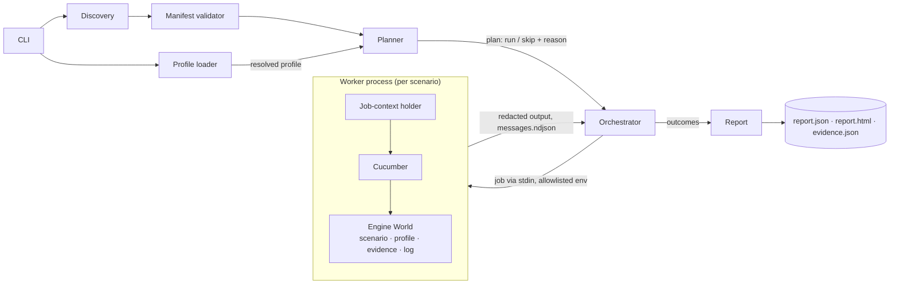

# fhEVM test engine

A manifest-driven, Cucumber-based engine for fhEVM end-to-end scenarios.

- **Declarative.** Every scenario is a folder with a `scenario.yaml` manifest and a Gherkin `.feature` file. Every target environment is a `profiles/<name>.yaml` file. Adding a test means adding a folder; there is no central registry.
- **Isolated.** Each scenario runs in its own Node.js process, so no Cucumber global and no open resource can leak into another scenario.
- **Honest.** A scenario either runs from start to end or is skipped as a whole, before execution, with a reason. Partial execution is impossible, and a run in which nothing ran never succeeds.
- **Auditable.** Every run produces the native Cucumber message stream and HTML report, the console log of each scenario, a consolidated `report.json` / `report.html`, and an `evidence.json`.
- **Safe with secrets.** Profile secrets never reach the repository, the worker environment or any output: every output is redacted before it is written.

The engine runs on Node.js (>= 22) and TypeScript compiled with `tsc`. No TypeScript loader is involved at runtime; Cucumber always loads plain JavaScript from `dist/`.

> **Status:** Phase 1a (engine infrastructure). Profiles, planner rules, the scenario World, evidence and secret handling are in place. No fhEVM scenario has been ported yet: the only scenario is `smoke.arithmetic`, which has no dependency on the stack. The Chain, FHE and contract-configuration modules come in Phase 1b.

## Quick start

```bash
cd test-suite/test-engine
npm ci
npm run build                          # compiles src/, scenarios/ and test/ to dist/

npm run engine -- list                 # discover and validate every scenario
npm run engine -- profiles             # list and validate every profile
npm run engine -- dry-run              # validate step bindings without executing anything
npm run engine -- run                  # run every enabled scenario (profile: none)
npm run engine -- run smoke.arithmetic
npm run engine -- run --tags "@smoke and not @slow"
npm run engine -- dry-run --profile testnet   # what would run on the TestNet, and why not
```

`npm run engine -- <args>` is the same as `node dist/src/cli/main.js <args>`.

> Rebuild after changing any `.ts` file, including step definitions: the engine only loads compiled JavaScript. If a scenario's support code has not been compiled, `list` and `run` report it.

## Terminology

| Term                 | Meaning                                                                                                                                    |
| -------------------- | ------------------------------------------------------------------------------------------------------------------------------------------ |
| **Scenario**         | A folder with a `scenario.yaml`. The unit that the engine selects, isolates, times out and reports.                                        |
| **Gherkin scenario** | A `Scenario:` (or one `Examples` row of a `Scenario Outline:`) inside the feature file. A scenario contains one or more Gherkin scenarios. |
| **Profile**          | A target environment (`none`, `local`, `devnet`, `testnet`, `mainnet`): its settings and whether it requires confirmation.                 |
| **Support code**     | The TypeScript step definitions (and optional World) of a scenario.                                                                        |

## Adding a scenario

1. Create a folder under `scenarios/`, e.g. `scenarios/my-area/my-scenario/`.
2. Add `scenario.yaml`:

   ```yaml
   apiVersion: fhevm.zama.ai/scenario/v1
   kind: Scenario

   metadata:
     id: my-area.my-scenario
     name: What this scenario verifies, in a few words
     owner: my-team
     description: A sentence or two describing what is verified and why.
     tags: [my-area]

   spec:
     runtime: cucumber
     entrypoint: ./my-scenario.feature
     supportCode:
       - ./steps.ts
     timeoutSeconds: 120
     targets: [local, devnet, testnet] # required for scenarios that use the fhEVM stack
   ```

3. Add the feature file and the step definitions (see `scenarios/smoke/` for a complete example).
4. Run `npm run build && npm run engine -- dry-run my-area.my-scenario`. This checks the manifest, the Gherkin syntax, and that every step is bound to exactly one definition.
5. Run it: `npm run engine -- run my-area.my-scenario --profile local`.

### Writing step definitions

Steps receive the engine context through `this.engine`. Import the engine API as `#engine`:

```ts
import { EngineWorld } from '#engine';
import { Given, When, setWorldConstructor } from '@cucumber/cucumber';

class MyWorld extends EngineWorld {
  total = 0;
}
setWorldConstructor(MyWorld);

When('Alice deposits {int}', function (this: MyWorld, amount: number) {
  const url = this.engine.profile.setting('example.url'); // throws if the profile does not define it
  this.total += amount;
  this.engine.log('deposit on', this.engine.profile.name, 'via', url); // redacted console line
  this.engine.evidence.record('example.deposit', { amount, total: this.total }, { label: 'Deposit' });
});
```

| Member                 | Content                                                                          |
| ---------------------- | -------------------------------------------------------------------------------- |
| `this.engine.scenario` | id, name, owner, tags, origin of the running scenario                            |
| `this.engine.profile`  | `name`, `settingKeys()`, `setting(key)`                                          |
| `this.engine.evidence` | `record(kind, data, { label })`: structured evidence (see [Evidence](#evidence)) |
| `this.engine.log(...)` | a console line, with secrets redacted                                            |

### Rules for support code

- **A custom World must extend `EngineWorld`.** An engine hook fails any Gherkin scenario whose World does not.
- **Do no work at import time.** Support code is imported even by `dry-run`. Connecting to an RPC, reading settings or creating SDK clients belongs in steps, hooks or the World, never at module top level.
- **Read configuration from the profile, never from `process.env`.** The worker only inherits an allowlist of variables (`PATH`, `HOME`, `TMPDIR`/`TEMP`/`TMP`, `TZ`, `LANG`, `LC_*`, `NODE_OPTIONS`, `NODE_EXTRA_CA_CERTS`, `NO_COLOR`/`FORCE_COLOR`, `SystemRoot`); profile values reach scenarios through `this.engine.profile`.
- **Keep state in the World.** Cucumber creates a fresh World for every Gherkin scenario. Do not keep module-level mutable state.
- **Gherkin scenarios are independent.** A Gherkin scenario must not rely on state left by another one. Put shared setup in a `Background`.
- **Never skip at runtime.** Returning `'skipped'` from a step or a hook fails the scenario (see [Execution guarantees](#execution-guarantees)). If a scenario cannot run on an environment, leave that profile out of its `targets`.
- **`BeforeAll` / `AfterAll` are unsupported.** They have no World and cannot record evidence.
- **Scenario globals are safe.** `setWorldConstructor`, `setDefaultTimeout` and `defineParameterType` only affect the calling scenario, because each scenario has its own process.

## Manifest reference

The schema is [`schema/scenario.v1.schema.json`](schema/scenario.v1.schema.json) (JSON Schema draft-07). Point your editor's YAML extension at it to get validation and completion.

**Every field is enforced at runtime, and unknown fields are rejected**, so a manifest never carries a field that does nothing.

| Field                  | Required | Description                                                                                                                                                                           |
| ---------------------- | -------- | ------------------------------------------------------------------------------------------------------------------------------------------------------------------------------------- |
| `apiVersion`           | yes      | `fhevm.zama.ai/scenario/v1`                                                                                                                                                           |
| `kind`                 | yes      | `Scenario`                                                                                                                                                                            |
| `metadata.id`          | yes      | Unique, stable id: lowercase words separated by `.` or `-` (e.g. `erc20.transfer`).                                                                                                   |
| `metadata.name`        | yes      | Human-readable name.                                                                                                                                                                  |
| `metadata.owner`       | yes      | Owning team.                                                                                                                                                                          |
| `metadata.description` | yes      | What the scenario verifies.                                                                                                                                                           |
| `metadata.tags`        | yes      | Selection tags, written **without** `@` (may be empty).                                                                                                                               |
| `metadata.origin`      | no       | The original test this scenario was ported from (traceability of behavioural equivalence).                                                                                            |
| `spec.runtime`         | yes      | `cucumber`                                                                                                                                                                            |
| `spec.entrypoint`      | yes      | Feature file, relative to the scenario folder. Must stay inside the folder.                                                                                                           |
| `spec.supportCode`     | no       | TypeScript files, relative to the scenario folder; the engine loads their compiled `.js`. Default `[]`.                                                                               |
| `spec.timeoutSeconds`  | yes      | Wall-clock budget of the scenario (integer, 1–86400). See [Timeouts](#timeouts).                                                                                                      |
| `spec.enabled`         | no       | `false` keeps the scenario on disk but always skips it, with the reason in the report. Default `true`.                                                                                |
| `spec.targets`         | no       | Profiles the scenario may run on (at least one, no duplicates). When absent: every profile **except** those requiring confirmation (mainnet), which must always be listed explicitly. |

Discovery also rejects duplicate ids, missing files, paths escaping the scenario folder, uncompiled support code, and `targets` naming unknown profiles (valid names: `none` plus the files of the profiles directory in use). If any manifest is invalid, `run` and `dry-run` refuse to start (exit 2) and `list` prints every problem.

## Profiles

A profile describes one target environment. Profiles live in `profiles/<name>.yaml` and are validated against [`schema/profile.v1.schema.json`](schema/profile.v1.schema.json) (unknown fields rejected).

```yaml
apiVersion: fhevm.zama.ai/profile/v1
kind: Profile
metadata:
  name: testnet # must match the file name; 'none' is reserved
  description: Public TestNet (Sepolia host chain)
spec:
  requiresConfirmation: false # true: `run` needs --confirm <name>
  envFiles: # optional, read in memory only
    - ./testnet.env
    - { path: ./local-overrides.env, optional: true }
  settings:
    example.url: { value: https://example.invalid } # literal (never for secrets)
    example.timeout: { env: EXAMPLE_TIMEOUT, default: 30 } # env var with fallback (never for secrets)
    example.token: { env: EXAMPLE_TOKEN, secret: true } # secret: from env or env file only
```

| Profile   | Confirmation | Notes                                                                                        |
| --------- | ------------ | -------------------------------------------------------------------------------------------- |
| `none`    | no           | Built-in default (no file, no settings). Only for scenarios that do not use the fhEVM stack. |
| `local`   | no           | Local stack started with `fhevm-cli`.                                                        |
| `devnet`  | no           |                                                                                              |
| `testnet` | no           |                                                                                              |
| `mainnet` | **yes**      | Real funds.                                                                                  |

The shipped profiles have no settings yet: the typed fhEVM sections (chain, relayer, wallets) arrive with the Phase 1b modules.

**Value resolution.** A setting is exactly one of `{ value }`, `{ env }` or `{ env, default }`. An `env` source is looked up in the process environment first, then in the env files, in order. Settings are resolved once, before any scenario runs: a missing variable or a missing (non-optional) env file stops the run with exit 2. Env files are never merged into `process.env`.

**Secrets.** `secret: true` marks a sensitive value. Secrets cannot have a literal `value` or a `default` (they never live in the repository) and must be at least 8 characters long. They are redacted from every output (see [Secret handling](#secret-handling)).

## Planner rules

For each selected scenario, the planner decides **before anything runs** whether it runs on the profile. The first matching rule wins:

| #   | Condition                                             | Decision | Reason (example)                                              |
| --- | ----------------------------------------------------- | -------- | ------------------------------------------------------------- |
| 1   | `spec.enabled: false`                                 | skip     | `disabled in manifest (spec.enabled: false)`                  |
| 2   | Profile requires confirmation and is not in `targets` | skip     | `profile 'mainnet' must be listed explicitly in spec.targets` |
| 3   | `targets` present and profile not in it               | skip     | `profile 'testnet' not in spec.targets [local]`               |
| 4   | Otherwise                                             | run      | —                                                             |

The rules apply identically in `run` and `dry-run`. A scenario requested by id is still skipped when a rule says so.

**Declaring where a scenario runs.** All the environments the engine targets share a common base (relayer, contract deployment, …), so the only restriction a scenario expresses is the list of profiles it runs on:

- **No `targets`:** every profile except those requiring confirmation, including the built-in `none`. Use it only for scenarios that do not touch the fhEVM stack (like the smoke).
- **`targets: [local]`:** local-stack-only scenarios (database checks, container control, node cheatcodes).
- **`targets: [local, devnet, testnet]`:** scenarios that run on every live environment except mainnet. Add `mainnet` only when the scenario is approved for real funds.

A scenario that uses the stack must declare `targets`: under the default `none` profile it would otherwise be planned and fail when it reads a setting `none` does not have.

**Confirmation.** On a profile with `requiresConfirmation: true` (mainnet), `run` refuses to start unless `--confirm <profile-name>` repeats the profile name. A confirmation with a different name, or on a profile that does not require it, is rejected too. `dry-run`, `list` and `profiles` need no confirmation. Mainnet therefore needs two explicit opt-ins: the scenario author lists it in `targets`, and the person running the engine confirms it.

## Execution guarantees

- **No partial execution.** In `run` mode, a step or hook result `SKIPPED` that does not follow a failed, undefined, ambiguous or pending result fails the scenario with `Runtime skip is not allowed: …`. Steps skipped after a failure are fine: the scenario has already failed.
- **No pending steps.** `pending` fails the scenario (strict mode).
- **No retries.** Retries are fixed at 0, so a retried pass can never hide a failure.
- **Invalid scenarios fail in both modes.** Gherkin parse errors, undefined parameter types, and undefined or ambiguous steps fail the scenario, also in `dry-run` (where Cucumber itself would report success).
- **Nothing executed is never a success.** When every selected scenario is skipped by the planner, the run exits 3 and still writes its report.
- **Tags select whole scenarios only.** There is no Gherkin-level tag filter.

## CLI reference

```
test-engine <command> [scenario-id...] [options]

Commands:
  list       List discovered scenarios (validates every manifest)
  run        Run the selected scenarios, one isolated process per scenario
  dry-run    Validate the selected scenarios without executing any step
  profiles   List and validate the profiles; with --profile, also resolve that profile
  help       Show the usage

Options:
  -p, --profile <name>       Target environment profile (default: none)
      --confirm <name>       Confirm a profile that requires it (required by run; accepted by dry-run;
                             must repeat the profile name; rejected by list and profiles)
  -t, --tags <expr>          Cucumber tag expression on manifest tags, e.g. "@smoke and not @slow"
      --scenarios-dir <dir>  Directory scanned for scenario.yaml files (default: <package>/scenarios)
      --profiles-dir <dir>   Directory holding <profile>.yaml files (default: <package>/profiles)
  -o, --output-dir <dir>     Run output directory (default: <package>/reports/<run-id>)
      --json                 list: print JSON instead of a table
  -v, --version              Print the engine version
```

**Selection.** Without ids or tags, every scenario is selected. Ids and `--tags` can be combined; a scenario must match both. Tag expressions use the [Cucumber syntax](https://github.com/cucumber/tag-expressions), with `@` in front of each manifest tag. An unknown id, an invalid expression or an empty selection is an error.

**Exit codes** (precedence when several apply: 130 > 1 > 3 > 0):

| Code | Meaning                                                                                                                                                                                                                  |
| ---- | ------------------------------------------------------------------------------------------------------------------------------------------------------------------------------------------------------------------------ |
| 0    | At least one scenario executed, and all executed scenarios passed (dry-run: are valid).                                                                                                                                  |
| 1    | At least one scenario failed, timed out or errored (dry-run: is invalid).                                                                                                                                                |
| 2    | Usage or configuration error: bad option, invalid manifest or profile, missing env var or env file, unknown id or profile, empty selection, missing or wrong `--confirm`. Nothing was executed and no report is written. |
| 3    | Nothing executed: every selected scenario was skipped by the planner. The report is written.                                                                                                                             |
| 130  | Interrupted (Ctrl+C / SIGTERM). The report of what already ran is written.                                                                                                                                               |

An unexpected internal error after scenarios started (for example, the report cannot be written) exits 1, never 2.

### `dry-run`

`dry-run` is a static validator. For each selected scenario, it validates the manifest and the profile, applies the planner rules, parses the feature file, loads the support code and checks that every step matches exactly one step definition. It **executes no step and no hook**, so it also needs no connectivity. `dry-run --profile <name>` shows what would run on a target and why the rest would be skipped. It validates the shape of a scenario, not its behaviour.

## Evidence

`this.engine.evidence.record(kind, data, { label })` records a piece of evidence on the running step or `Before`/`After` hook:

- `kind`: a short, namespaced name made of lowercase words separated by `.` or `-` (e.g. `engine.note`; Phase 1b modules will add `chain.tx`, `fhe.relayer-job`, …);
- `data`: a JSON object; secret values are redacted before it is stored.

Each call adds a Cucumber attachment (media type `application/vnd.fhevm.evidence+json`), visible in the Cucumber report and in the terminal, and the report extracts it into `evidence.json`. Calling `record()` while no step or hook is running (e.g. from the World constructor, a `setTimeout`, or without awaiting) throws `evidence.record() must be called (and awaited) inside a step or hook`.

`evidence.json` (`schemaVersion: 1`, type `EvidenceFile` in [`src/report/evidence.ts`](src/report/evidence.ts)) holds one entry per piece of evidence, each with a `scope`:

| Scope      | Produced by | Content                                                                                                                                                |
| ---------- | ----------- | ------------------------------------------------------------------------------------------------------------------------------------------------------ |
| `run`      | the engine  | `engine.run` (engine and Node versions, git commit, times, filters) and `engine.profile` (name, confirmation, settings with sources, secrets redacted) |
| `scenario` | the engine  | `engine.scenario`: plan decision and reason, outcome, timings (also for skipped scenarios)                                                             |
| `step`     | `record()`  | kind, label, data, timestamp, Gherkin scenario and step                                                                                                |
| `hook`     | `record()`  | same, with the hook instead of the step                                                                                                                |

## Secret handling

Every output is redacted **before it is written**: nothing unredacted reaches the disk.

| Output                                            | Where redaction happens                                                                       |
| ------------------------------------------------- | --------------------------------------------------------------------------------------------- |
| Evidence data, `this.engine.log`                  | in the scenario process, before attaching / printing                                          |
| `messages.ndjson`, `cucumber-report.html`         | in the worker, message by message (the worker writes them itself from Cucumber's `onMessage`) |
| Worker stdout/stderr (terminal and `console.log`) | in the engine, line by line, before printing or writing                                       |
| `report.json`, `report.html`, `evidence.json`     | in the report builder                                                                         |

Redaction replaces the raw, JSON-escaped and URL-encoded forms of each secret with `[REDACTED:<setting key>]`. A secret transformed in other ways (base64, hashed, split across lines) is not detected; never log transformed secrets. In addition, the worker never receives the profile environment variables, and the job (profile included) reaches the worker through stdin, never through its command line.

## Outputs

Each `run` / `dry-run` writes a run directory (default `reports/<run-id>/`, ignored by git):

```
reports/20261006-143006-run-ae7e/
├── report.json                    # consolidated, machine-readable result
├── report.html                    # self-contained human-readable report
├── evidence.json                  # every piece of evidence of the run
└── scenarios/
    └── smoke.arithmetic/          # only for scenarios that reached a worker
        ├── messages.ndjson        # native Cucumber message stream (canonical source)
        ├── cucumber-report.html   # native Cucumber HTML report
        └── console.log            # the scenario's console output, without ANSI colours
```

`report.json` (`schemaVersion: 1`, type `RunReport` in [`src/report/report.ts`](src/report/report.ts)) contains the engine and Node versions; the run (id, mode, times, filters, profile snapshot, git commit, interrupted flag); a summary (counts per outcome, `executed`, `success`); and per scenario its metadata, targets, requirements, plan decision, outcome, reason, timings, evidence count, artifact paths and the parsed Cucumber execution (Gherkin scenarios, steps, hooks that failed or recorded evidence, issues).

| Outcome     | Meaning                                                                                                                           |
| ----------- | --------------------------------------------------------------------------------------------------------------------------------- |
| `passed`    | Cucumber reported success and the engine found no problem (dry-run: valid).                                                       |
| `failed`    | A step or hook failed, or a step is undefined, ambiguous or skipped at runtime, or the feature does not parse (dry-run: invalid). |
| `skipped`   | Not executed. `reason` says why (planner rule, or run interrupted).                                                               |
| `timed-out` | The scenario exceeded its budget and was stopped. The partial message stream is kept.                                             |
| `error`     | The worker could not run Cucumber, e.g. support code throwing at import. `reason` holds the error.                                |

## Timeouts

`spec.timeoutSeconds` is applied at two levels:

1. **Default step timeout.** It becomes Cucumber's default step timeout inside the scenario process. A single hanging step fails with a clear Cucumber timeout error, and the scenario is `failed`.
2. **Scenario budget.** If the scenario is still running `timeoutSeconds + 5 s` after it started, the engine sends `SIGTERM`; the worker flushes what it recorded and exits, and the scenario is `timed-out`. A worker that does not exit within 3 s (e.g. a step blocking the event loop) receives `SIGKILL`.

## Architecture



| Component      | Code                         | Contract (input → output)                                                                                                           |
| -------------- | ---------------------------- | ----------------------------------------------------------------------------------------------------------------------------------- |
| Manifest       | `src/manifest/`              | YAML → `ScenarioManifest` or `ManifestError(problems[])`. Pure.                                                                     |
| Discovery      | `src/discovery/`             | scenarios dir + known profiles → valid `DiscoveredScenario`s + one error per invalid manifest.                                      |
| Profiles       | `src/profiles/`              | profiles dir + name + environment → `ResolvedProfile` (plain data) or `ProfileError(problems[])`.                                   |
| Planner        | `src/planner/`               | scenarios + filters + profile → `ExecutionPlan` (run/skip + reason); confirmation rules. Pure.                                      |
| Runner         | `src/runner/orchestrator.ts` | `ExecutionPlan` → `ScenarioRunResult[]`, one per plan item; redacted console tee.                                                   |
| Worker         | `src/runner/worker.ts`       | `WorkerJob` (stdin) → redacted Cucumber artifacts + exit code (`0` passed, `1` failed/invalid, `2` engine error, `143` terminated). |
| Engine API     | `src/api/` (`#engine`)       | `EngineWorld`, `ProfileView`, `Evidence`.                                                                                           |
| Engine support | `src/cucumber/support/`      | loaded first in every worker: default step timeout, default World, EngineWorld check.                                               |
| Secrets        | `src/secrets/redactor.ts`    | secret values → redactor for text, objects and streams.                                                                             |
| Report         | `src/report/`                | plan + results + message streams → `RunReport` → `report.html`, `evidence.json`; shared `findExecutionProblems`.                    |
| CLI            | `src/cli/`                   | argv → exit code.                                                                                                                   |

## Development

```bash
npm run build          # clean build to dist/
npm test               # node:test suites (unit + CLI integration), on the compiled output
npm run tsc            # type-check only
npm run prettier:check # formatting (same rules as the repository root)
```

The CLI integration tests run the engine against `test/fixtures/scenarios/` with the fixture profiles of `test/fixtures/profiles/`. The fixtures cover passing, failing, undefined, ambiguous and unparsable scenarios, crashes at import, step and scenario timeouts, disabled scenarios, isolation, runtime skips (step, hook, after a failing hook), Worlds not extending `EngineWorld`, missing settings, planner skips (targets, confirmation), evidence from steps and hooks, and secret redaction across every output. `test/fixtures/invalid-scenarios/` and `test/fixtures/invalid-profiles/` hold deliberately invalid files.
